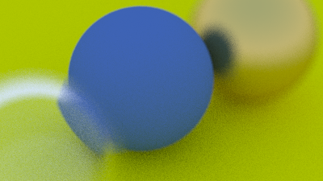
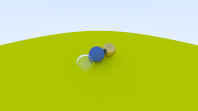
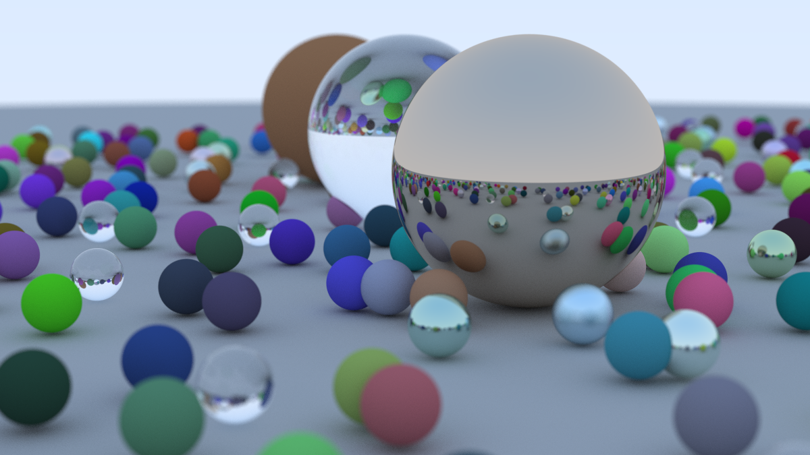

# Zig Ray Tracer

A CPU ray tracer written in Zig, following [*Ray Tracing in One Weekend*](https://raytracing.github.io/books/RayTracingInOneWeekend.html) by Peter Shirley, Trevor David Black, and Steve Hollasch.

It uses Zig-idiomatic, data-oriented patterns instead of class hierarchies and `shared_ptr`.

## Example renders

Sample output is in [`example_render/`](example_render/) as `.ppm` files

### Preview

<details open>
<summary>Click to hide/show rendered image preview</summary>
<br>

<table>
  <tr>
    <td align="center" width="50%">
      <br>
      <sub>Defocus blur (close-up)</sub>
    </td>
    <td align="center" width="50%">
      <br>
      <sub>Distant view</sub>
    </td>
  </tr>
  <tr>
    <td align="center" colspan="2">
      <br>
      <sub>Final render</sub>
    </td>
  </tr>
</table>

</details>

## Features

- Sphere intersection with front/back face detection
- Anti-aliasing via multi-sampling per pixel
- Gamma-corrected output (gamma 2)
- Materials:
  - Lambertian (diffuse)
  - Metal (with fuzz)
  - Dielectric (glass, with total internal reflection and Schlick reflectance)
- Positionable camera (`vfov`, `lookfrom`, `lookat`, `vup`)
- Defocus blur (depth of field)
- Plain PPM (P3) image output

## Requirements

- [Zig](https://ziglang.org/download/) **0.16.0**. The standard library changed a lot around `std.Io`, so other versions may not compile.

## Build and run

```sh
zig build run
```

The render is written to `output.ppm` in the directory you run the command from. Progress is printed to stderr.

While developing, lower the settings (for example 400px wide, 50 samples per pixel, depth 20) for much faster iteration.

## Project structure

```
.
├── build.zig
├── build.zig.zon
├── example_render/     # sample .ppm renders
└── src/
    ├── main.zig        # builds the scene, configures the camera, calls render
    └── core/           # ray tracer internals
```

`src/core/` contains the camera, rays, vectors, intervals, hittable shapes and list, materials, and color output.

## Design notes

| Book (C++) | This project (Zig) |
|---|---|
| `hittable` base class + virtual `hit` | Tagged union (`union(enum)`) with a `switch` |
| `bool hit(..., hit_record& rec)` | `hit(...)` returns `?HitRecord` |
| `scatter(..., color&, ray&)` out-parameters | `scatter(...)` returns `?Scatter` |
| `vector<shared_ptr<hittable>>` | `std.ArrayList(Hittable)`, contiguous in memory |
| `vec3` class | `@Vector(3, f32)` |
| Global `random_double()` | `std.Random` handle passed explicitly |
| Camera with public/private fields | `Camera.init(InitOptions)` computes all derived state |
| Materials shared via `shared_ptr` | Material stored by value inside each sphere |


## Possible next steps

- Multithreading (pixels are independent)
- A BVH for faster ray-object intersection (*Ray Tracing: The Next Week*)
- Textures, lights, and more shapes

## Credits

Based on [*Ray Tracing in One Weekend*](https://raytracing.github.io/books/RayTracingInOneWeekend.html) (v4) by Peter Shirley, Trevor David Black, and Steve Hollasch.
